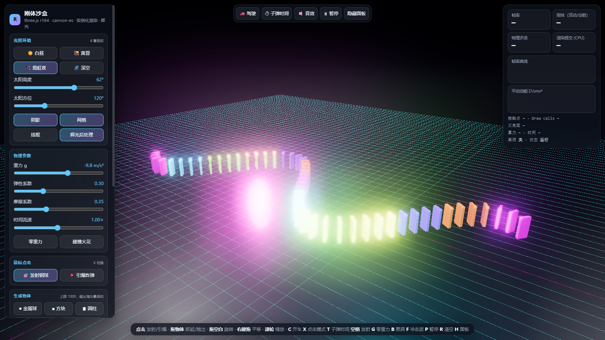
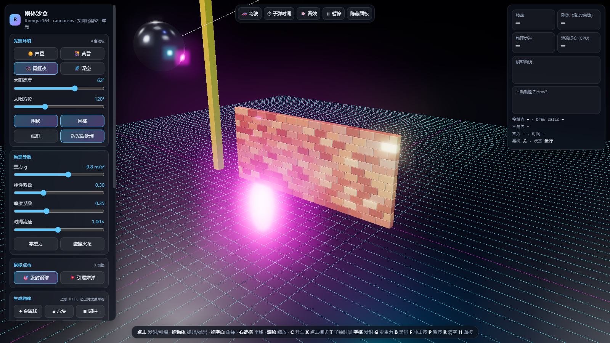
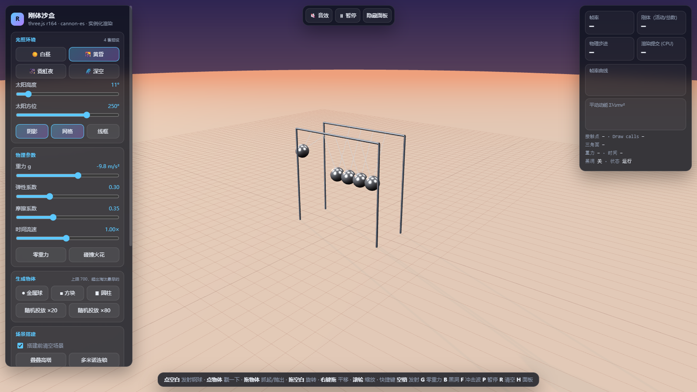
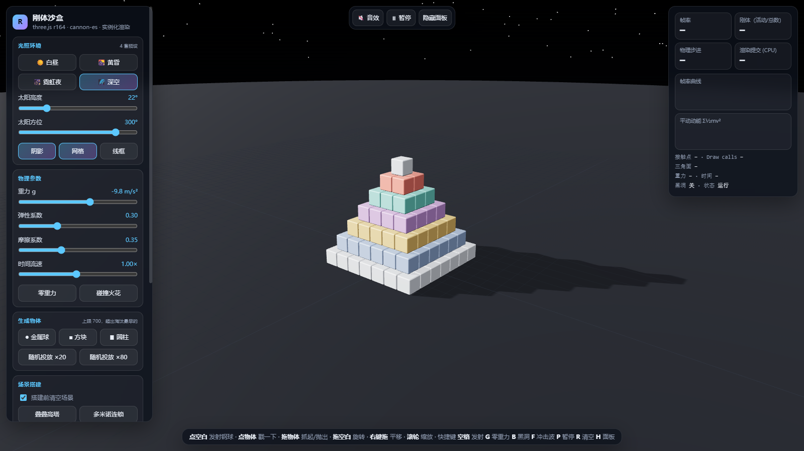

# AI 3D 对决：刚体物理沙盒

同一道题，Claude 和 Gemini 各写一个“带物理碰撞、光影切换、交互控制面板的单文件 3D 模拟器”，然后放在同一个浏览器里实测对比。

**在线试玩**：<https://bosswenwu.github.io/ai-3d-battle/>

| 文件 | 作者 | 在线地址 |
|---|---|---|
| [`index.html`](index.html) | Claude（Opus 5.5） | [打开](https://bosswenwu.github.io/ai-3d-battle/) |
| [`gemini/v1-aetherphysx.html`](gemini/v1-aetherphysx.html) | Gemini（自称 “Gemini 4 Argon”，未核实） | [打开](https://bosswenwu.github.io/ai-3d-battle/gemini/v1-aetherphysx.html) |
| [`gemini/v2-cloud-ai.html`](gemini/v2-cloud-ai.html) | 同上，“Cloud & AI 升级版” | [打开](https://bosswenwu.github.io/ai-3d-battle/gemini/v2-cloud-ai.html) |

| 霓虹夜 · 砖墙 + 拆迁球 | 黄昏 · 牛顿摆 | 深空 · 金字塔 |
|---|---|---|
|  |  |  |

## 直达链接

用 URL 参数直接进入某个场景：

| 场景 | 链接 |
|---|---|
| 特技坡道（开车飞跃，撞倒球瓶和箱子墙） | [`?preset=sunset&scene=ramp`](https://bosswenwu.github.io/ai-3d-battle/?preset=sunset&scene=ramp) |
| 砖墙 + 拆迁球 | [`?preset=neon&scene=wreck`](https://bosswenwu.github.io/ai-3d-battle/?preset=neon&scene=wreck) |
| 多米诺连锁 | [`?preset=neon&scene=dominoes`](https://bosswenwu.github.io/ai-3d-battle/?preset=neon&scene=dominoes) |
| 牛顿摆 | [`?preset=sunset&scene=cradle`](https://bosswenwu.github.io/ai-3d-battle/?preset=sunset&scene=cradle) |
| 方块金字塔 | [`?preset=space&scene=pyramid`](https://bosswenwu.github.io/ai-3d-battle/?preset=space&scene=pyramid) |

`preset`：`day` / `sunset` / `neon` / `space`；`scene`：`tower` / `dominoes` / `cradle` / `pyramid` / `wreck` / `ramp`。

本地打开也可以，单文件双击即可，需要能访问 cdn.jsdelivr.net。开车需要键盘。

## Claude 版功能

- **开车**：`C` 上车/下车。RaycastVehicle 四轮独立悬挂，W/S 油门倒车、A/D 转向、空格手刹、R 翻正，追尾镜头，实时车速
- **场景**：叠叠高塔（45 块）、多米诺连锁（51 块）、牛顿摆、方块金字塔（140 块）、砖墙 + 拆迁球（174 块错缝砖 + 23 kg 摆锤 + 塔吊）、特技坡道（坡道 + 10 个球瓶 + 35 块箱子墙）
- **鼠标**：点击发射钢球，或切到引爆炸弹（`X`）；按住物体拖动可以抓起、甩出（点对点约束）；拖空白处旋转视角，右键平移，滚轮缩放
- **力场**：黑洞引力场（带旋转分量和阻尼）、径向冲击波、爆炸（冲量随距离衰减 + 火球 + 闪光 + 低频轰鸣）、零重力
- **时间**：时间流速滑杆、子弹时间（`T`，0.15×）、暂停；物理用固定步长 + 插值渲染，慢动作也平滑
- **光照**：白昼 / 黄昏 / 霓虹夜 / 深空四套预设，太阳高度和方位可调，PBR 材质 + 环境反射，Unreal Bloom 辉光后处理，霓虹预设下物体按各自颜色自发光
- **碰撞反馈**：按冲击速度合成音效（Web Audio），强碰撞迸出火花
- **存档**：本地快照（明确标注只存在当前浏览器）+ 导出/导入 JSON 文件；导入时逐条校验，坏数据跳过
- **遥测**：帧率、物理步进耗时、渲染耗时、活动/总刚体数、接触点数、平动动能、draw calls，全部是实时计算值
- **性能压测**：逐批加刚体，直到帧率持续低于 40 或达到 1000 个上限，报告结果
- **性能设计**：同类形状用 InstancedMesh 实例化渲染；刚体数量设上限，超出时淘汰最早生成的

## 实测对比（2026-10-14，同一浏览器，1600×900 视口）

| 项目 | Gemini v1 | Gemini v2 “升级版” | Claude |
|---|---|---|---|
| 按钮 / 控制台报错 | 无 | 无 | 无（33 个按钮全部点过） |
| 200 个刚体时每帧 draw call（不含后处理） | 190~212 | 同 v1 | **7** |
| 圆柱体的物理形状 | 外观是圆柱，碰撞体是**方盒**（滚不起来） | 同 v1 | 真圆柱（12 边凸多面体） |
| 抓取拖拽物体 | 无 | 无 | 有 |
| 可驾驶车辆 | 无 | 无 | 有：3 秒加速到 114 km/h，车身倾角 ≤3°；坡道飞跃最高 4.8 m，10/10 球瓶、35/35 箱子被撞开 |
| 多米诺 / 牛顿摆 / 拆迁 | 无 | 无 | 51/51 块骨牌倒下；牛顿摆中间球不动，末球峰值 1.42→1.39→1.36 缓慢衰减；拆迁球 5 秒撞散 145/174 块砖 |
| “云端存档” | — | 实际只写 `localStorage`，却提示“可在任意设备随时加载” | 标注为本地快照，另提供文件导出/导入 |
| “Gemini 4 AI 指挥官” | — | 关键词匹配 + `setTimeout(600)` 假装在思考；输入无关指令也提示“执行完毕” | 不做假 AI |
| 存档往返 | — | 多面柱读回来变成方块，颜色随机打乱 | 形状、尺寸、颜色完全一致（已测） |
| 相对 v1 的功能 | — | 删掉了脉冲推力、线框、网格开关 | — |

### 测量说明

- 测试时浏览器面板处于后台，计时波动很大（同一场景渲染从 7.6ms 到 30.7ms 不等），所以**不比较帧率**，只列能稳定复现的指标（draw call 数、功能是否真实存在、物理行为）。
- 物理步进耗时两边接近（200 个刚体约 1ms 量级）。早期一次测到 Gemini 29.5ms，复测不能复现，已作废。
- 物理行为数据（车速、倒下数量等）由脚本按固定步长逐帧推进得到，可复现。
- Gemini 的模型名称和“100 万 token 输出”等自述均未核实。

## Claude 版开发中修掉的问题（如实记录）

自测时发现并修复了这些问题，没有藏起来：

1. **黑洞吸不起物体**：吸力太弱，物体只在地面滑。加强后又出现弹弓效应，把物体甩出场外（平均距离 9→25）。加入场内阻尼后，1.5 秒内收拢到中心，关闭后正常落回。
2. **多米诺推不倒**：cannon 的摩擦按重力估算滑动上限，骨牌斜靠时摩擦被高估，会互相撑住。改为骨牌间摩擦 0、骨牌与地面摩擦 1.0，并在搭建后 15 秒内禁止休眠。
3. **牛顿摆凭空获得能量**：末球摆得比初始还高（1.42→2.4）。原因是顺序冲量求解器加位置修正，在一排紧贴的球上注入能量；调接触刚度、子步和球间距都压不住。最后改为摆球之间按一维等质量弹性碰撞精确交换法向速度，摆球与其他物体仍走 cannon。
4. **车轮在半个地图踩不到地**：cannon-es 的静态刚体在构造函数里就按单位旋转算好了 AABB，之后给地面平面设旋转不会刷新；射线检测先查 AABB，于是 z>0 半边全部漏检（物体碰撞走包围球，不受影响，所以之前没暴露）。设完姿态后标记 `aabbNeedsUpdate` 修复，坡道等静态件同样处理。
5. **车一加速就翘头翻车**：驱动力作用在轮胎接地点，离质心太远，俯仰角一度到 70°。把质心下移到车身底部、转动惯量 ×2.5、驱动力随车速衰减后，全油门倾角 ≤3°。
6. **坡道开不上去**：坡道低端高出地面约 0.3 m，形成台阶挡住车头；下沉到与地面齐平。
7. **霓虹预设过曝**：自发光 + 低阈值辉光把砖墙打成一片白，下调自发光强度并提高辉光阈值。
